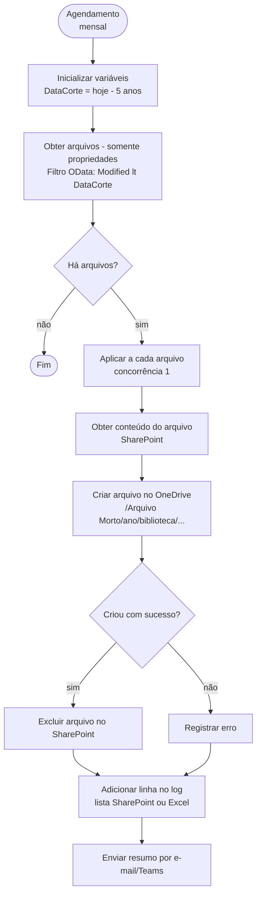

# 🗄️ Arquivamento automático de arquivos antigos do SharePoint (Power Automate)

[](https://github.com/rafacampanha/power-automate-arquivamento-sharepoint/actions/workflows/testes.yml)

Fluxo do **Power Automate** que encontra arquivos de bibliotecas do SharePoint **sem modificação há mais de 5 anos** e os move para um local de arquivo morto no **OneDrive**, liberando espaço e organizando o acervo, com log de tudo o que foi movido.

> Versão genérica e documentada de um fluxo que construí no trabalho. Nomes de sites, bibliotecas e contas são fictícios.

## Problema

- Cota de armazenamento do SharePoint crescendo sem controle.
- Bibliotecas cheias de arquivos que ninguém abre há anos, atrapalhando a busca.
- Limpeza manual demorada e arriscada.

## Solução



## Passo a passo do fluxo

| # | Ação | Configuração principal |
|---|---|---|
| 1 | **Recorrência** | 1x por mês, fora do horário comercial |
| 2 | **Inicializar variável** `DataCorte` (String) | `formatDateTime(addDays(utcNow(), -1826), 'yyyy-MM-ddTHH:mm:ssZ')` |
| 3 | **Obter arquivos (somente propriedades)** | Consulta de filtro: `Modified lt '@{variables('DataCorte')}' and FSObjType eq 0` · paginação ligada (limite 5000) |
| 4 | **Aplicar a cada** | Paralelismo 1 (evita throttling e conflito de nomes) |
| 5 | **Obter conteúdo do arquivo** | Identificador do item atual |
| 6 | **Criar arquivo (OneDrive)** | Pasta: `/Arquivo Morto/@{formatDateTime(items('Aplicar_a_cada')?['Modified'],'yyyy')}/@{items('Aplicar_a_cada')?['{Path}']}` |
| 7 | **Condição** | `outputs('Criar_arquivo')?['statusCode']` igual a `200` |
| 8 | **Excluir arquivo (SharePoint)** | Só no ramo "sim", ou seja, nunca exclui sem ter cópia |
| 9 | **Adicionar linha (log)** | Nome, caminho original, caminho novo, data de modificação, status, erro |
| 10 | **Escopo de erro** | "Configurar execução após" = falhou/esgotou → notifica o responsável |

### Expressões úteis

```text
// 5 anos atrás (considerando bissextos)
addDays(utcNow(), -1826)

// Caminho relativo sem o nome da biblioteca
replace(items('Aplicar_a_cada')?['{Path}'], 'Documentos Compartilhados/', '')

// Tamanho em MB para o relatório
div(float(items('Aplicar_a_cada')?['{FileSize}']), 1048576)
```

## Cuidados e boas práticas

- **Modo teste primeiro:** rodar com a ação de exclusão desativada e só gerar o log, para validar a lista com a área dona dos arquivos.
- **Copiar → validar → excluir:** a exclusão só acontece quando a cópia deu certo.
- **Throttling:** paralelismo baixo e paginação ligada para bibliotecas grandes.
- **Permissões:** a conexão usada precisa de acesso de leitura/exclusão na biblioteca e escrita no OneDrive de destino.
- **Retenção e compliance:** confirmar se a biblioteca não tem política de retenção ou rótulo que impeça a exclusão.

## Simulador em Python

Para testar a regra antes de ligar o fluxo, a pasta [`simulador/`](simulador) tem um script que aplica **a mesma lógica numa pasta local** (dry-run por padrão):

```bash
python simulador/arquivar.py "C:/MinhaPasta" "D:/ArquivoMorto" --anos 5            # só lista
python simulador/arquivar.py "C:/MinhaPasta" "D:/ArquivoMorto" --anos 5 --executar # move e gera log.csv
python -m pytest
```

## Resultado

- Rotina que antes era manual passou a rodar sozinha todo mês.
- Log auditável de cada arquivo movido.
- Redução do volume ocupado nas bibliotecas e busca mais limpa.

## Tecnologias

Power Automate · SharePoint Online · OneDrive · OData · Python (simulador)
